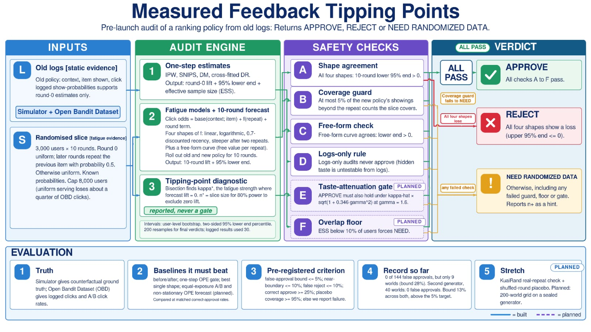

# Measured Feedback Tipping Points

Pre-rollout audit for ranking policies (Perceptron Hackathon 2026, Problem 3: *"Did the Policy Actually Work, or Did It Just Look Like It?"*, off-policy evaluation).

**The idea in one paragraph.** A new ranking policy can look better in old logs and still be worse after launch, because users tire of seeing the same item again and again. A standard one-step estimate cannot see that. This project measures the user-fatigue coefficient (kappa-hat) from a small randomised slice, finds the *tipping point* kappa\* where the new policy's forecast lift becomes zero, and returns one of three verdicts: **APPROVE**, **REJECT**, or **NEED RANDOMIZED DATA**.

> Everything here runs on our own simulators. No production or personal data is used, and no external service or credential is required.



## Quick start (about 2 minutes)

```bash
python -m venv .venv && source .venv/bin/activate      # Windows: .venv\Scripts\activate
pip install -r requirements.txt
python -m p3ope demo        # two live audits: a harmful policy and a good one (~30 s)
python -m p3ope ope         # one-step IPW/SNIPS/DR baseline vs truth (instant)
python -m p3ope summary     # headline numbers from the 288 logged audits (instant)
python -m p3ope report      # builds docs/dashboard.html, open it in any browser
```

Run every command from the repository root. Verified on Python 3.12.3 (the original authors also tested 3.13).

| Command | What it does |
|---|---|
| `python -m p3ope demo` | Runs the final audit on two simulated policies and prints each verdict next to the simulator's ground truth. |
| `python -m p3ope audit --kind cubic --kappa 0.2 --seed 1` | Audits one scenario (~12 s). Add `--json` for machine-readable output, `--no-truth` to skip the ground-truth step, `--boot 200` for a steadier bootstrap (about 40 s; the default 30 reproduces the logged runs). |
| `python -m p3ope ope --beta 0.5 --gamma 0.8` | The one-step IPW / SNIPS / DM / DR baseline next to the exact truth. With `--beta 0 --gamma 0` it is accurate; with hidden taste it is biased. |
| `python -m p3ope kinds` | Lists the 22 fatigue shapes the simulator can generate. |
| `python -m p3ope summary` | Prints false-approval / correct-approve counts (with 95% bounds) from `results/`. |
| `python -m p3ope report` | Writes the self-contained results dashboard `docs/dashboard.html` (no JavaScript, no network). |

An audit with the same `--kind`, `--kappa` and `--seed` as a logged run reproduces that record exactly (checked by `tests/test_reproduce.py`).

### What the demo shows

For `cubic`, kappa = 0.5 the one-step estimate says the new policy lifts clicks by **+0.084**, while the true 10-round lift is **-0.019**. The audit does not approve it. The final rule (v7) returns NEED RANDOMIZED DATA because the four fatigue models disagree; the free-form model on its own already rejects.

## Repository layout

```
.
├── docs/
│   ├── abstract.md            Round-1 abstract (v46, about 900 words; earlier versions in docs/archive/)
│   ├── PREREGISTRATION.md     Thresholds fixed before each run (addenda 1-20)
│   ├── RESULTS.md             Pass/fail outcome for every claim, per round
│   ├── COMPUTE_BUDGET.md      NEW  measured time/memory per audit, parallelism, drop order
│   ├── FILE_MAP.md            Old flat filenames -> current paths
│   ├── dashboard.html         Generated results dashboard (python -m p3ope report)
│   └── improvement/           Change report, test report, feature status, demo guide
├── p3ope/                     Core library
│   ├── ope_pilot.py           Base world (K=10 items, D=5 features), IPW/SNIPS/DM/DR
│   ├── exp13_lib.py           Multi-mechanism feedback simulator, fitting, bootstrap, forecast, tipping point, verdict
│   ├── r2_lib.py              Fatigue shapes, slice kappa estimators
│   ├── r4_lib.py              Second held-out generator (probit link, heterogeneous fatigue)
│   ├── r5_lib.py              Tail-targeted slice design, tipping-margin audit
│   ├── r8_lib.py              Third held-out generator W3 (step/expo/late fatigue, taste-coupled kappa)
│   ├── r12_lib.py             Free-form count-curve model (fifth shape, used by rule v7)
│   ├── r15_lib.py             NEW  generator W7: multiplicative fatigue, category spillover, recovery, taste x fatigue; 40 random worlds
│   ├── audit.py               NEW  one-call entry point for the final rule: run_audit(kind, kappa, seed)
│   ├── summary.py             NEW  headline statistics computed from results/
│   ├── report.py              NEW  builds docs/dashboard.html
│   └── cli.py, __main__.py    NEW  python -m p3ope ...
├── experiments/               One script per experiment (rN_eM = round N, experiment M)
├── analysis/                  Scripts that turn results/ into the pass/fail tables
├── tests/                     NEW  unittest suite (fast + slow reproduction checks)
├── figures/                   Final figures + scripts that build them
├── results/                   Raw run logs (.jsonl / .log / .csv)
│   └── standin_superseded/    Earlier stand-in-world runs, kept for the record only
└── requirements.txt
```

## Testing

```bash
python -m unittest tests.test_core          # ~50 s: imports, verdict logic, log integrity, headline numbers
python -m unittest tests.test_reproduce     # ~30 s: fresh audits must match the logged records exactly
python -m unittest discover -s tests        # everything (~80 s)
```

`tests.test_core` prints some tables while it imports the `analysis/` scripts; that is expected (those scripts print on import).

## Configuration

There are no secrets, API keys or databases. The only settings are optional environment variables read by the simulator (defaults reproduce every logged run; do not change them when reproducing results):

| Variable | Default | Meaning |
|---|---|---|
| `P3_ALPHA` | `0.8` | How closely the old (logging) policy follows true click logits |
| `P3_TAUOLD` | `1.0` | Old policy softmax temperature |
| `P3_TN` | `0.5` | New policy softmax temperature |
| `P3_SLICE` | `slice` | `experiments/r8_e2` only: `slice` or `tail` slice design |
| `P3_CELLS` | `all` | `experiments/r8_e2` only: comma list such as `step,late` |

## Reproducing the runs

Each run appends to its output file and resumes if restarted. One audit takes about 3-12 s on one CPU core. Running a script with missing arguments prints its usage line.

```bash
python -m experiments.r3_e3 300 316 results/r3_e3.jsonl
python -m experiments.r4_e2 500 530 results/r4_e2.jsonl
python -m experiments.r4_e1 400 424 results/r4_e1.jsonl
python -m experiments.r5_e1 design results/r5_design.jsonl
python -m experiments.r5_e1 curve  results/r5_curve.jsonl
python -m experiments.r3_e1 200 214 results/r3_e1.jsonl
python -m experiments.r6_e1 results/r6.jsonl
# Round 8-9 (judge-panel fixes: logs-only under hidden taste; held-out generator W3; tail slice)
python -m experiments.r8_e1 3000 3016 results/r8_e1.jsonl
python -m experiments.r8_e2 4000 4016 results/r8_e2.jsonl
P3_SLICE=tail P3_CELLS=step,late python -m experiments.r8_e2 5000 5016 results/r9_e1.jsonl
# Round 7: final four-shape rule (about 60 min on two cores; each pair of commands can run in parallel)
python -m experiments.r7_e1 1000 1016 results/r7_e1_a.jsonl   # and: 1016 1032 results/r7_e1_b.jsonl
python -m experiments.r7_e2 1100 1110 results/r7_e2_a.jsonl   # and: 1110 1120 results/r7_e2_b.jsonl
python -m experiments.r7_e3 1200 1208 results/r7_e3_a.jsonl   # and: 1208 1216 results/r7_e3_b.jsonl
python -m experiments.r7_e4 1300 1308 results/r7_e4_a.jsonl   # and: 1308 1316 results/r7_e4_b.jsonl
```

Arguments are `SEED0 SEED1 OUT` (see each script's docstring for the exact usage).

## Reproducing the analysis

```bash
python -m analysis.an_r3_e3
python -m analysis.an_r4
python -m analysis.an_r5      # also regenerates figures/reliability_tipping_margin.png
python -m analysis.an_r6
python -m analysis.an_r3_e1
python -m analysis.an_percell
python -m analysis.an_r7
python -m experiments.r10_e1 6000 6032 results/r10_e1.jsonl   # n* with pilot band
python -m analysis.an_r8
python -m experiments.r11_e1 7000 7016 results/r11_e1.jsonl   # rule v6, fourth generator
python -m analysis.an_r10
python -m experiments.r12_e1 8000 8016 results/r12_e1.jsonl W5   # rule v7, free-form veto
python -m experiments.r12_e1 8000 8008 results/r12_e1_w4.jsonl W4
python -m analysis.an_r11
python -m analysis.an_r12
# Round 13 (strict-panel fixes): guard stress, drift MVP, ablation from saved logs
P3_TN=0.2 python -m experiments.r13_e1 9000 9004 results/r13_e1_a.jsonl   # and: 9004 9008 results/r13_e1_b.jsonl (about 5 min each)
python -m experiments.mvp_drift 0 200 results/mvp_drift_dir_d1.0.jsonl 1.0          # covariate drift along DRIFT_DIR (not adverse for the new policy)
P3_DRIFT_MODE=logit python -m experiments.mvp_drift 0 200 results/mvp_drift_logit_d1.0.jsonl 1.0   # uniform logit shift: before/after wrong sign 200/200
python -m analysis.an_r13   # also prints the ablation and the logs-only false-reject check
python -m analysis.an_ablation   # NEW: pooled shape ablation + decision-value metric (post hoc, from saved logs)
# Round 15 (third panel): structurally different generator W7, larger bootstrap, slice-bias mechanism
python -m experiments.r15_e1 20000 20003 results/r15_e1.jsonl   # 40 worlds x 3 datasets, about 13 min
python -m experiments.r15_e2 200 results/r15_e2.jsonl            # 48 R14 datasets re-run at B = 200, about 50 min
python -m experiments.r15_e3 results/r15_e3.jsonl                # hidden-taste bias of slice kappa-hat, about 15 s
python -m analysis.an_r15
```

Figures: `python figures/make_diagram.py` renders `figures/diagram.html` from the results.

## Results

[`docs/RESULTS.md`](docs/RESULTS.md) lists each pre-registered claim with its pass/fail outcome, and [`docs/PREREGISTRATION.md`](docs/PREREGISTRATION.md) holds the thresholds as written before the runs. Failed targets are reported in full. `python -m p3ope report` turns the same logs into a one-page dashboard.

## Not done

Fatigue that starts only at the third or later repeat is not covered (R8-2, R9-1 failed their targets). n* band covers the oracle in 85% of pilots (target 90%), see Round 10. Rule v6 (repeat-heavy 10-round slice + coverage guard) still gives 18/144 false approvals on delayed-onset fatigue (target 5%), see Round 11; the v7 free-form veto brings that to 0/144 on a fresh generator (Round 12).
Round 13: with a sharper new policy the coverage guard fires in 96/96 audits, so the audit abstains rather than approves (0/24 correct-approves); the MVP drift check at half strength (logit shift 0.5) misses its 50% target (96/200 wrong sign); on fresh generators the free-form model alone matches the full rule (0/144), so four-shape agreement is partly redundant. The Open Bandit control (P17) is documented but its script is not in this archive.
KuaiRand (stretch goal), sequential slice sizing, sensitivity bounds. Closed-loop slice sizing was dropped because it fails in the real-world setting.

`python -m p3ope audit` runs the verdict rule (v7) only; it does not print the n\* slice size, which lives in `experiments/r3_e1.py` and `experiments/r10_e1.py`.

## Panel-review fixes (v44)

A dry-run judge panel on the abstract flagged: length, inconsistent counts, undefined terms, no compute budget or drop order, no ablation isolating four-shape agreement, no decision-loss metric. Done here: abstract cut and terms defined; `docs/COMPUTE_BUDGET.md`; `analysis/an_ablation.py` (four-shape agreement vs single shapes vs free-form alone, plus value per audit with false approvals weighted by lambda = 1, 5, 10). Finding: on the two generators seen during rule building, four-shape agreement gave 13/216 false approvals (tail-weighted shape alone also 13/216) while the free-form model alone and the final rule gave 1/216, so safety comes mainly from the free-form model and the guard. These are post hoc and descriptive; `docs/PREREGISTRATION.md` and `docs/RESULTS.md` were not edited.

Not done (needs data or time we do not have here): KuaiRand dynamics check, head-to-head with Chandak-style non-stationary OPE, comparison with an MSM-bound tipping value, held-out-pilot check of the n* winner's-curse bias, and one prior project per team member (only the team can supply that).

## Panel-review fixes (v46)

Third dry-run panel (4 ADVANCE, 1 REJECT at 3.90). Done: abstract cut to about 900 words with n*, the candidate policy and the interval method defined; slice-bias mechanism explained and verified (`experiments/r15_e3.py`); OBD miss diagnosed; timeline reconciled; `--boot` option and a B = 200 re-check (`experiments/r15_e2.py`); structurally different generator W7 with 40 independent worlds (`p3ope/r15_lib.py`, `experiments/r15_e1.py`), all pre-registered criteria met (Addendum 20, RESULTS Round 15). Not done: diagram/text alignment (skipped by request) and one real prior project per team member.

## Troubleshooting

| Symptom | Fix |
|---|---|
| `ModuleNotFoundError: p3ope` | Run from the repository root, not from inside a sub-folder. |
| `result log not found: results/...` | Same cause: the code reads `results/` and `figures/` with relative paths. |
| `unknown fatigue shape` | Run `python -m p3ope kinds` for the valid names. |
| An experiment prints only a usage line | It needs its positional arguments, see "Reproducing the runs". |
| `analysis.an_r5` changes `figures/reliability_tipping_margin.png` | Expected: it regenerates that figure. |
| Numbers differ slightly after upgrading numpy/scipy | Logged runs were produced with the versions in `requirements-tested.txt`; verdict counts should match, last decimals may not. |

## Notes

- `docs/RESULTS.md` and `docs/PREREGISTRATION.md` are the historical record and still use the original flat script names; see [`docs/FILE_MAP.md`](docs/FILE_MAP.md). They were not edited.
- `e5_full.py` / `e5_diag.py` (the full Open Bandit Dataset runs in the P17-P19 section) were not in the supplied archive, so they are not included here.
- The abstract's repository URL is filled in (this repository).
- Rounds 1-6 slice and R2-3 logs-only results used a three-shape rule (lin, log, mem7); the abstract's final rule has four shapes (adds tail2). Round 7 re-tests the headline claims under the final rule; see docs/RESULTS.md.
- Importing an experiment module sets a few module-level constants (for example `r2_lib.NF = 3000`) to match the logged runs. Do not mix experiment modules with different settings in one Python process.
