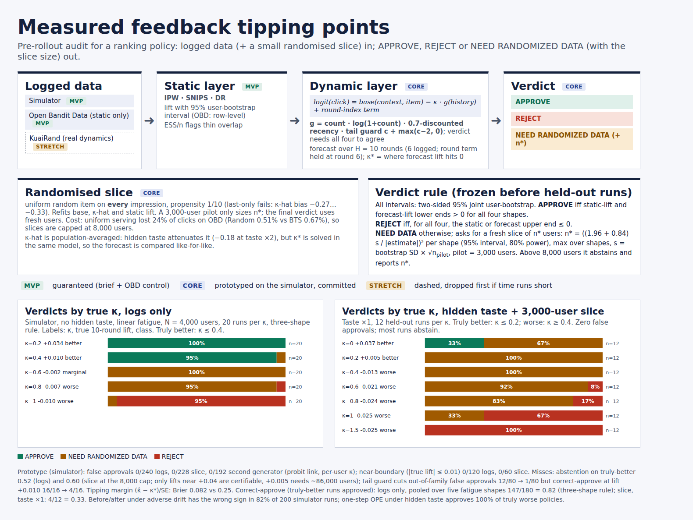

# Measured Feedback Tipping Points

Pre-rollout audit for ranking policies (Perceptron Hackathon 2026, Problem 3: *"Did the Policy Actually Work, or Did It Just Look Like It?"*, off-policy evaluation).

The audit returns one of three verdicts: **APPROVE**, **REJECT**, or **NEED RANDOMIZED DATA** (with the size of the randomized slice required). It compares a measured user-fatigue coefficient (kappa-hat) against the *tipping point* kappa\*, the fatigue level at which the new policy's forecast lift becomes zero.

This repository holds the simulator, the audit code, every experiment, the raw run logs, and the pre-registered pass/fail record, including all failed targets.



## Repository layout

```
.
├── docs/
│   ├── abstract.md            Round-1 abstract (v37)
│   ├── PREREGISTRATION.md     Thresholds fixed before each run (addenda 1-10)
│   ├── RESULTS.md             Pass/fail outcome for every claim, per round
│   └── FILE_MAP.md            Old flat filenames -> current paths
├── p3ope/                     Core library
│   ├── ope_pilot.py           Base world (K=10 items, D=5 features), IPW/SNIPS/DM/DR
│   ├── exp13_lib.py           Multi-mechanism feedback simulator, fitting, bootstrap, forecast, tipping point, verdict
│   ├── r2_lib.py              Fatigue shapes, slice kappa estimators
│   ├── r4_lib.py              Second held-out generator (probit link, heterogeneous fatigue)
│   └── r5_lib.py              Tail-targeted slice design, tipping-margin audit
├── experiments/               One script per experiment (rN_eM = round N, experiment M)
├── analysis/                  Scripts that turn results/ into the pass/fail tables
├── figures/                   Final figures + scripts that build them
├── results/                   Raw run logs (.jsonl / .log / .csv)
│   └── standin_superseded/    Earlier stand-in-world runs, kept for the record only
└── requirements.txt
```

## Setup

```bash
python -m venv .venv && source .venv/bin/activate
pip install -r requirements.txt
```

Tested with Python 3.12 and 3.13. Run everything from the repository root.

## Reproducing the runs

Each run appends to its output file and resumes if restarted. One audit takes about 3-6 s on one CPU core.

```bash
python -m experiments.r3_e3 300 316 results/r3_e3.jsonl
python -m experiments.r4_e2 500 530 results/r4_e2.jsonl
python -m experiments.r4_e1 400 424 results/r4_e1.jsonl
python -m experiments.r5_e1 design results/r5_design.jsonl
python -m experiments.r5_e1 curve  results/r5_curve.jsonl
python -m experiments.r3_e1 200 214 results/r3_e1.jsonl
python -m experiments.r6_e1 results/r6.jsonl
```

Arguments are `SEED0 SEED1 OUT` (see each script's docstring for the exact usage).

## Reproducing the analysis

```bash
python -m analysis.an_r3_e3
python -m analysis.an_r4
python -m analysis.an_r5      # also regenerates figures/reliability_tipping_margin.png
python -m analysis.an_r6
python -m analysis.an_r3_e1
python -m analysis.an_percell
```

Figures: `python figures/make_diagram.py` renders `figures/diagram.html` from the results.

## Results

[`docs/RESULTS.md`](docs/RESULTS.md) lists each pre-registered claim with its pass/fail outcome, and [`docs/PREREGISTRATION.md`](docs/PREREGISTRATION.md) holds the thresholds as written before the runs. Failed targets are reported in full.

## Not done

KuaiRand (stretch goal), sequential slice sizing, sensitivity bounds. Closed-loop slice sizing was dropped because it fails in the real-world setting.

## Notes

- `docs/RESULTS.md` and `docs/PREREGISTRATION.md` are the historical record and still use the original flat script names; see [`docs/FILE_MAP.md`](docs/FILE_MAP.md).
- `e5_full.py` / `e5_diag.py` (the full Open Bandit Dataset runs in the P17-P19 section) were not in the supplied archive, so they are not included here.
- The abstract has one placeholder: the repository URL.
